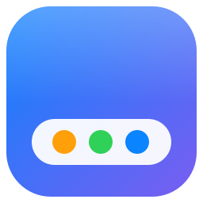
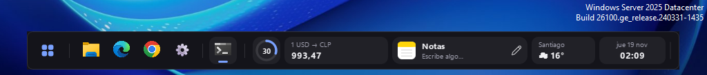
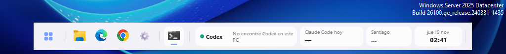
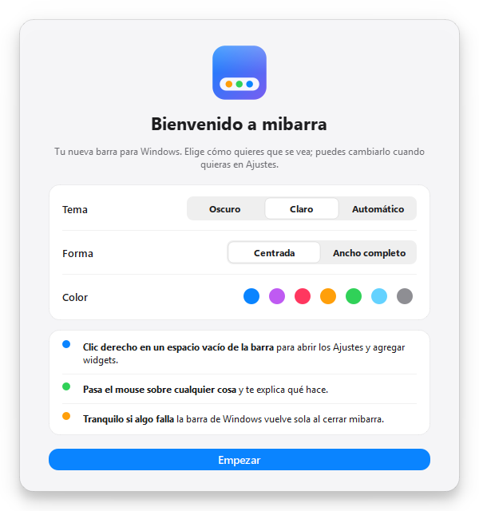
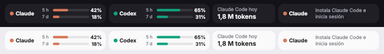

<div align="center">



# mibarra

**Una barra para Windows 10 y 11 con tus apps, las ventanas abiertas y widgets en vivo. Estilo Apple, gratis y de código abierto.**

[](https://github.com/Vecx06/mibarra/actions/workflows/pruebas.yml)
[](https://github.com/Vecx06/mibarra/releases/latest)
[](LICENSE)


[**⬇ Descargar**](https://github.com/Vecx06/mibarra/releases/latest) · [Novedades](CHANGELOG.md) · [Reportar un problema](https://github.com/Vecx06/mibarra/issues/new/choose)




<sub>Capturas reales tomadas en Windows por las pruebas automáticas del proyecto.</sub>

</div>

## Descargar e instalar

1. Entra a **[la última versión](https://github.com/Vecx06/mibarra/releases/latest)**.
2. Descarga **`mibarra-X.Y.Z-instalador.exe`** y ábrelo.
3. Siguiente, siguiente, listo. No necesitas Python ni permisos de administrador.

> **"Windows protegió tu PC":** sale porque mibarra es nueva y no está firmada (firmar un programa cuesta dinero).
> Haz clic en **Más información → Ejecutar de todas formas**. El código está completo aquí para que cualquiera lo revise.

**¿Sin instalar?** Descarga `mibarra-X.Y.Z-portable.zip`, descomprímelo y abre `mibarra.exe`.

## Qué trae

- **Centrada como en Windows 11:** mide justo lo que ocupa y se anima al abrir y cerrar apps. También puede ir de borde a borde, abajo o arriba.
- **Tus apps:** fijadas y abiertas, agrupadas por programa. Un punto indica que está abierta y una rayita de color, que es la que estás usando.
- **24 widgets en vivo** (tabla más abajo), incluidos **tus límites de Claude y Codex** y los tokens de Claude Code.
- **Buscador rápido** con **Alt + Espacio**, estilo Spotlight: programas, carpetas, ajustes, cuentas y webs.
- **Atajos de teclado** y opción de **ocultarse sola** para tener la pantalla entera.
- **Tema claro, oscuro o automático**, con efecto vidrio y el color de acento que elijas.
- **Ajustes estilo Apple:** galería de widgets con buscador. Los cambios se aplican al tiro.
- **Modo edición:** con los Ajustes abiertos, cada widget muestra un círculo rojo **−** para quitarlo.
- **Se esconde** con videos, juegos o presentaciones en pantalla completa.
- **Reserva su espacio:** las ventanas maximizadas no quedan debajo de ella.
- **Segura:** al cerrarla, la barra de Windows vuelve exactamente como estaba. Y si mibarra se cae, un *guardián* la devuelve solo.

| Galería de widgets | Apariencia |
|---|---|
|  |  |

<p align="center"><br><sub>La bienvenida, la primera vez que abres mibarra.</sub></p>

### Widgets

<p align="center"><br><sub>Widgets de IA (datos de ejemplo).</sub></p>

| Widget | Qué hace |
|---|---|
| **Límites de Claude** | Cuánto llevas de tu sesión de 5 horas y de la semana, y cuándo se renueva. Te avisa al pasar el 90% |
| **Tokens de Claude Code** | Los tokens que llevas hoy en Claude Code |
| **Límites de Codex** | Tu sesión de 5 horas y la semana en Codex (ChatGPT) |
| **Reloj** | Hora y fecha. Clic: calendario |
| **Comando** | Escribe y aprieta Enter: `notepad` abre el programa, `youtube.com` la página, `?gatos` busca en Google, `=15*3` calcula |
| **Notas** | Una nota rápida que se guarda sola |
| **Enfoque** | Temporizador de 25 minutos para estudiar |
| **Conexiones** | Wi-Fi (con el nombre de tu red), Bluetooth y modo avión |
| **Claro / oscuro** | Cambia todo Windows entre modo claro y oscuro |
| **Capturas** | Recortar, capturar la pantalla y abrir la carpeta de capturas |
| **Música** | Canción que suena, con anterior, pausa y siguiente |
| **Volumen** | Rueda del mouse para subir y bajar. Clic: silenciar |
| **Clima** | Temperatura de tu ciudad |
| **Moneda** | Conversor (por ejemplo 1 USD → CLP). Clic: invertir |
| **CPU, RAM, Red** | Uso del PC y velocidad de internet |
| **Anillos de CPU y batería** | Lo mismo, como anillos que se llenan |
| **Disco, Almacenamiento** | Espacio usado y libre |
| **Batería** | Carga y tiempo restante (solo notebooks) |
| **Progreso del año** | Cuánto del año ya pasó |
| **Bandeja** | Muestra un rato la barra de Windows (wifi, íconos ocultos, notificaciones) |

## Cómo se usa

- **Buscar y abrir cualquier cosa:** **Alt + Espacio**, escribe y Enter.
- **Esconder o mostrar la barra:** **Ctrl + Alt + B** (los atajos se cambian en Ajustes › Comportamiento).
- **Apps:** clic para abrir o traer al frente, **clic con la rueda** para otra ventana, **girar la rueda** para pasar entre sus ventanas.
- **Ajustes:** clic derecho en un espacio vacío de la barra → **Ajustes de mibarra…**
- **Agregar widgets:** Ajustes › Widgets › **＋ Agregar**.
- **Fijar una app:** clic derecho sobre su ícono → **Fijar al dock**.
- **Ayuda en cualquier parte:** pasa el mouse sobre algo y te explica qué hace.

## Preguntas frecuentes

**La barra de Windows quedó escondida.** Abre **Inicio › Restaurar barra de Windows**. Normalmente no hace falta, porque el guardián lo hace solo.

**¿Cómo la desinstalo?** Desde *Configuración › Aplicaciones*, como cualquier programa. La barra de Windows vuelve a la normalidad.

**¿Dónde están mis ajustes y notas?** En `%APPDATA%\mibarra`, o en Ajustes › Acerca de › **Abrir carpeta**. Desde ahí también puedes respaldarlos.

**¿Funciona con dos monitores?** Por ahora la barra aparece solo en el monitor principal.

**El widget de Claude dice "Instala Claude Code e inicia sesión".** Los límites del plan se leen de la sesión de
[Claude Code](https://claude.com/claude-code). Si usas solo claude.ai, al hacer clic en el widget se abre tu página de uso.

**Alt + Espacio no abre el buscador.** Puede que otro programa (por ejemplo PowerToys) ya use ese atajo:
cámbialo en Ajustes › Comportamiento.

**Los íconos de la bandeja (Discord, Steam…) no aparecen.** Usa el widget **Bandeja** para ver la barra de Windows un rato.

## Privacidad

mibarra no tiene cuentas ni telemetría y no envía datos tuyos a ningún servidor propio. Solo se conecta a internet para:
- el **clima**, con [Open-Meteo](https://open-meteo.com) y la ciudad que elijas;
- la **moneda**, con [open.er-api.com](https://open.er-api.com) y las monedas que elijas;
- revisar si hay **versiones nuevas** en GitHub (se puede desactivar);
- los **límites de Claude**: usa la sesión que Claude Code ya guardó en tu PC solo para preguntarle a Anthropic
  (`api.anthropic.com`) cuánto llevas usado. Ese permiso no se guarda, no se anota y no se envía a nadie más.

Los **tokens de Claude Code** y los **límites de Codex** se leen de archivos de tu propio PC, sin internet.

Tus notas y ajustes se quedan en tu PC.

## Para desarrolladores

```bat
git clone https://github.com/Vecx06/mibarra
cd mibarra
python -m pip install -r requirements.txt -r requirements-opcional.txt
python main.py
```

- **Pruebas:** `python -m pytest`. En GitHub corren en un Windows real con cada cambio: abren la barra de verdad, revisan que la barra de Windows vuelva a como estaba y sacan las capturas de esta página.
- **Crear el `.exe`:** `python construir.py` (PyInstaller). El instalador se arma con [Inno Setup](https://jrsoftware.org/isinfo.php) (`instalador.iss`). Cuando se publica una versión, GitHub hace las dos cosas solo.
- Detalles del código, cómo agregar un widget y cómo publicar: [CONTRIBUTING.md](CONTRIBUTING.md).

Hecho en Python con PyQt6, psutil y ctypes.

## Lo que viene

- Soporte para varios monitores
- Vista previa de las ventanas al pasar el mouse
- Arrastrar para reordenar apps y widgets en la barra
- Íconos reales para las apps de la Microsoft Store

¿Tienes una idea? [Propónla aquí](https://github.com/Vecx06/mibarra/issues/new/choose).

## Licencia

[MIT](LICENSE) © Vecx06. Puedes usarlo, modificarlo y compartirlo, siempre que mantengas el aviso de autor.

---

<details>
<summary><b>English</b></summary>

**mibarra** is a free, open-source taskbar replacement for Windows 10 and 11: pinned and running apps plus 24 live widgets
(Claude & Codex usage limits, Claude Code tokens, weather, music, network, CPU/RAM, notes, currency converter,
Wi-Fi/Bluetooth toggles and more), a Spotlight-style launcher (Alt+Space), global shortcuts, auto-hide,
centered like Windows 11, with light/dark themes and an Apple-style settings window.
Download the installer from [Releases](https://github.com/Vecx06/mibarra/releases/latest). The UI is in Spanish.
</details>
