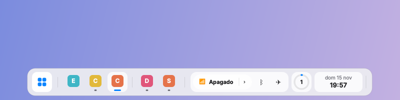
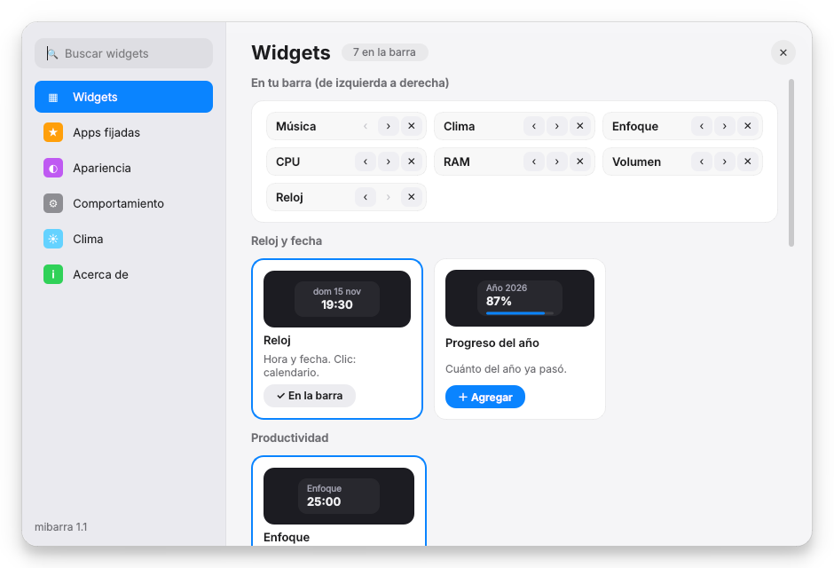
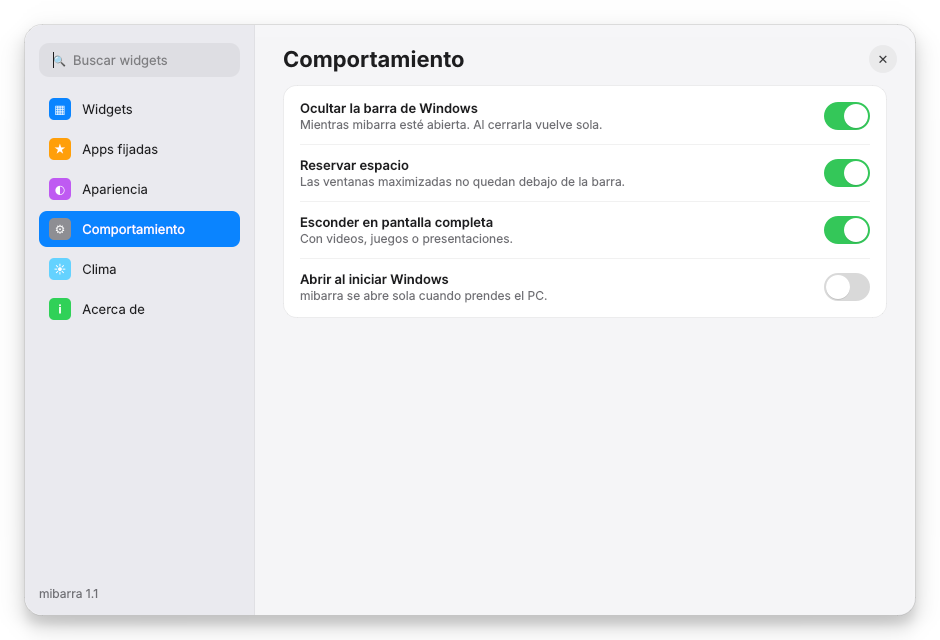
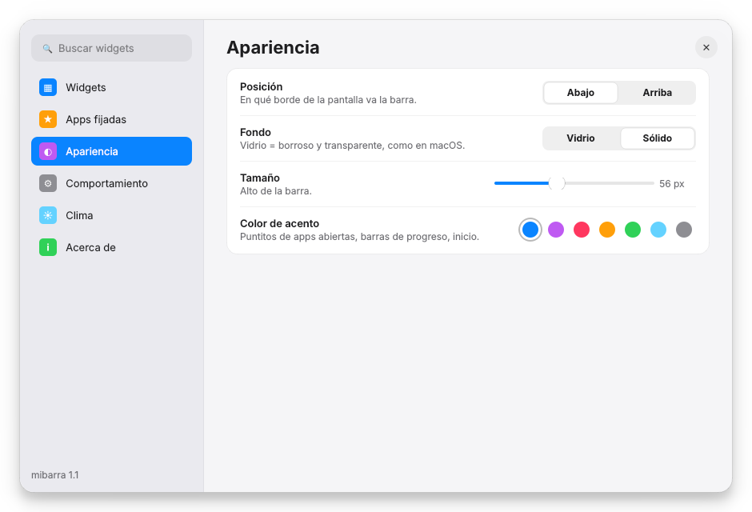
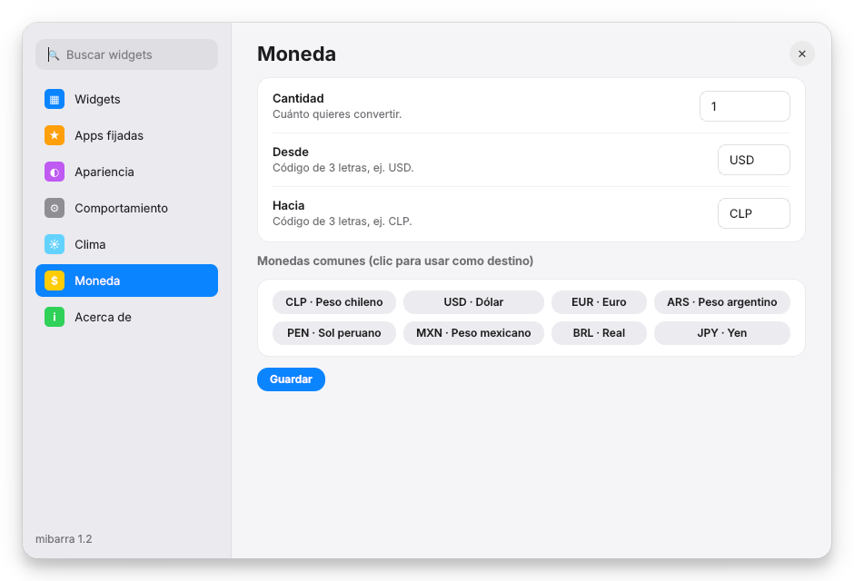

# mibarra

Una barra para **Windows 10 y 11** que reemplaza a la barra de tareas: tus apps, las ventanas abiertas y widgets en vivo, todo en una sola barra. Hecha en **Python + PyQt6**, inspirada en docks como lumabar.

## Qué trae

- **Apps fijadas y abiertas**, agrupadas por programa. Un punto indica que la app está abierta y una rayita de color, que es la ventana activa.
- **21 widgets en vivo:** comando (abre programas, páginas, busca o calcula), notas, Wi-Fi/Bluetooth/modo avión, claro/oscuro de Windows, capturas de pantalla, anillos de batería y CPU, conversor de moneda, almacenamiento, música, clima, velocidad de internet, CPU, RAM, disco, batería, volumen, reloj con calendario, progreso del año y un temporizador de estudio (Enfoque).
- **Centrada como en Windows 11**: mide justo lo que ocupa y crece o se achica con una animación al abrir y cerrar apps (o ancho completo, si prefieres).
- **Tema claro, oscuro o automático** (sigue a Windows).
- **Ajustes estilo Apple:** galería de widgets con buscador, apps fijadas, apariencia, comportamiento y clima. Los cambios se aplican al tiro.
- **Modo edición:** mientras los Ajustes están abiertos, cada widget muestra un círculo rojo **−** para quitarlo.
- **Efecto vidrio** (fondo borroso), color de acento a elección, barra abajo o arriba.
- Se **esconde sola** con videos, juegos o presentaciones en pantalla completa.
- **Reserva su espacio**, así que las ventanas maximizadas no quedan debajo de ella.
- Al cerrarla, la barra de Windows vuelve exactamente como estaba.

| Galería de widgets | Comportamiento |
|---|---|
|  |  |

| Apariencia | Moneda |
|---|---|
|  |  |

> Las capturas usan apps y datos de ejemplo.

## Instalación

1. Instala [Python](https://www.python.org/downloads/). Al instalarlo, **marca "Add Python to PATH"**.
2. Descarga este repositorio: botón verde **Code → Download ZIP**, y descomprímelo.
3. Haz doble clic en **`instalar.bat`**.
4. Haz doble clic en **`iniciar.bat`**.

Para cerrarla: clic derecho en un espacio vacío de la barra → **Cerrar mibarra**.
Si algo sale mal y la barra de Windows queda escondida: doble clic en **`restaurar_barra.bat`**.

El manual completo está en [LEEME.md](LEEME.md).

## Cómo está hecha

| Archivo | Qué contiene |
|---|---|
| `main.py` | Punto de partida: crea la app, carga los ajustes y abre la barra |
| `config.py` | Lee y guarda `config.json` |
| `estilo.py` | Colores, letras y estilos de menús |
| `dock.py` | La barra: inicio, íconos de apps, ubicación en pantalla, menús, modo edición |
| `ajustes.py` | La ventana de Ajustes (interruptores, galería, buscador) |
| `widgets.py` | Los widgets básicos (y las clases base `Caja` y `Tile`) |
| `mas_widgets.py` | Widgets de la 1.2: comando, notas, conexiones, tema, capturas, anillos, moneda, almacenamiento |
| `sistema_windows.py` | Todo lo que habla con Windows usando `ctypes`: ventanas abiertas, ocultar la barra, reservar espacio, efecto vidrio, teclas multimedia |

## Limitaciones conocidas

- Funciona solo en el monitor principal.
- Los íconos de la bandeja (wifi, Discord, Steam…) no aparecen en mibarra; el botón **⌃** muestra la barra de Windows un rato.
- Las apps de la Microsoft Store aparecen con un ícono de letra.
